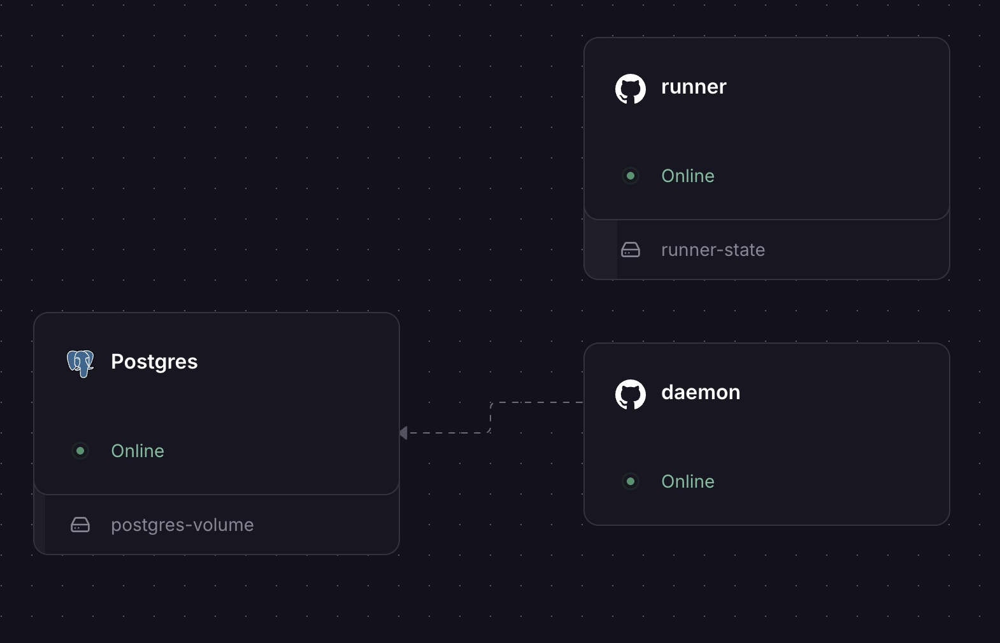

# Wakeplane

[](https://github.com/justyn-clark/wakeplane/actions/workflows/ci.yml)
[](LICENSE)

Wakeplane schedules work, records each occurrence durably, and tracks what happened. Run it locally or as a private service with SQLite or Postgres.

[Documentation](https://wakeplane.dev) · [Download v1.0.0](https://github.com/justyn-clark/wakeplane/releases/tag/v1.0.0) · [Release notes](docs/public/releases/v1.0.0.md)

## What it does

- Cron, interval, once, and event-triggered schedules with explicit timezones.
- HTTP, shell, and registered workflow targets, with retries, timeouts, overlap policies, and durable run history.
- An operator console, CLI, REST API, and MCP tools for creating schedules and inspecting outcomes.
- Tracked remote jobs and a separate example runner with Discord and Gmail delivery.

## Get started

Install on macOS or Linux:

```sh
curl -fsSL https://wakeplane.dev/install.sh | sh
WAKEPLANE_HTTP_ADDR=127.0.0.1:8080 wakeplane serve
```

Open `http://127.0.0.1:8080/console/`. Follow the [quickstart](docs/public/quickstart.md) to create your first schedule. For archives, checksums, Windows source builds, and `go install`, see [installation](docs/public/install.md).

Wakeplane 1.0 supports a single operator on a trusted network. Bearer authentication is available; RBAC and multi-tenancy are not. See the [security guidance](SECURITY.md) before hosting and the [stable contract](docs/public/stable-contract.md) for compatibility and limits.

<a href="docs/public/in-production.md"></a>

[See Wakeplane in production](docs/public/in-production.md) - real setups, delivery evidence and a short walkthrough.

## Documentation

| Start with              | Guide                                                                                                                      |
| ----------------------- | -------------------------------------------------------------------------------------------------------------------------- |
| Schedules and execution | [Schedules](docs/public/schedules.md), [policies](docs/public/policies.md), [run history](docs/public/run-states.md)       |
| Assistants and reports  | [Automation](docs/public/automation.md), [recipes](docs/public/recipes.md)                                                 |
| Production examples     | [Case study](docs/public/in-production.md), [visuals and runnable examples](docs/production-evidence.md)                   |
| API and command line    | [REST API](docs/public/api.md), [CLI](docs/public/cli.md)                                                                  |
| Hosting and storage     | [Hosting](docs/public/hosting.md), [storage and migration](docs/public/storage.md), [deployment adapters](infra/README.md) |
| Operations              | [Runbook](docs/public/runbook.md), [release status](docs/public/status.md)                                                 |
| Development             | [Developer guide](docs/development.md), [embedding](docs/public/embedding.md), [contributing](CONTRIBUTING.md)             |

## License

[MIT](LICENSE).
