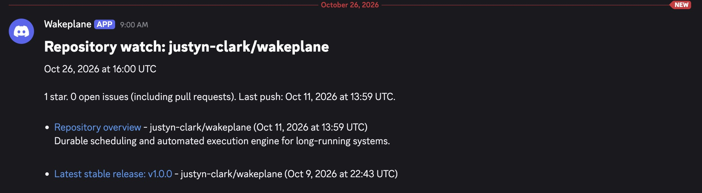
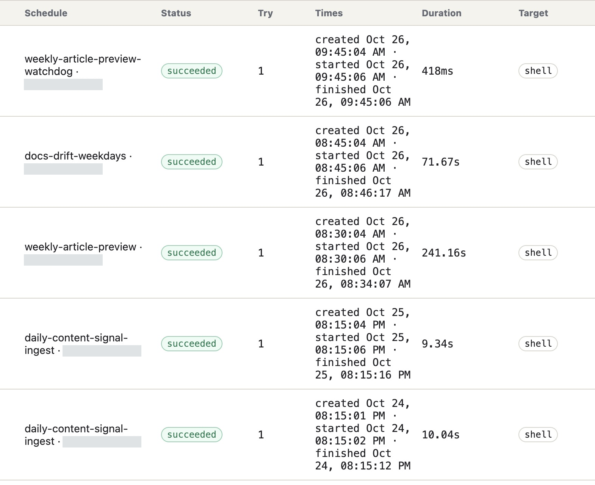
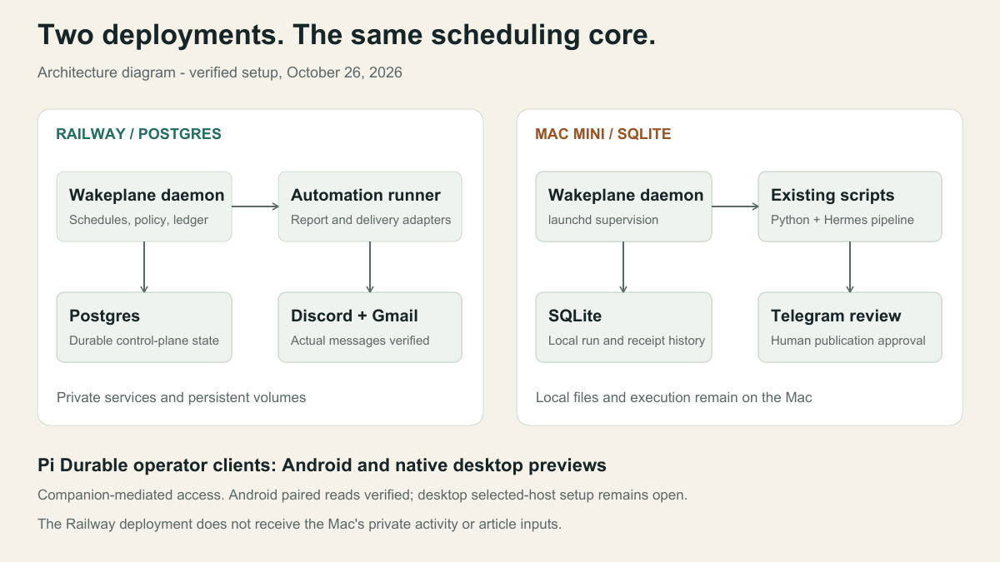
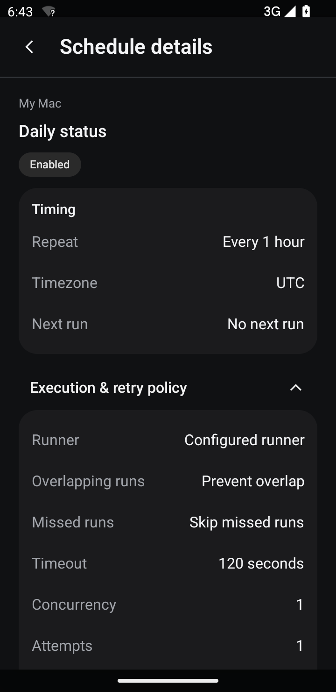

# Wakeplane in production

Operator case study

## Scheduled work. Recorded outcomes.

Reports on Railway. Local scripts on a Mac Mini. Actual runs and delivered notifications.

[Watch the walkthrough](#watch-the-workflow)
[Read the case study](../media/production-2026-10/case-study.pdf)

Captured October 26, 2026. Original UI, cropped and masked for privacy.

<figure>

<figcaption>Railway / Daemon, runner and Postgres with persistent volumes.</figcaption>
</figure>

<strong>1.0.0</strong>Verified on hosted and local daemons

<strong>Two environments</strong>Private Railway service and local Mac

<strong>Actual delivery</strong>Discord readback and Gmail INBOX

## Watch the workflow

<video controls preload="none" poster="../media/production-2026-10/poster.png" aria-label="Recorded Wakeplane console, Railway deployment and Discord delivery">
  <source src="../media/production-2026-10/walkthrough.mp4" type="video/mp4" />
  [Watch the recorded walkthrough](../media/production-2026-10/walkthrough.mp4).
</video>

The recording shows existing run history, schedule inspection, the production services and a delivered report. It uses actual browser samples with their original timing. No jobs were triggered for the demonstration.

<section class="production-panel">

## Hosted reports

The Railway deployment separates the Wakeplane daemon, Postgres and the automation runner. The database and runner use persistent volumes. The services run privately; notification delivery belongs to the runner.

Repository reports run at 9 AM Pacific on weekdays. A release digest runs Mondays at 9 AM. Both October 26 occurrences succeeded on their first attempt. The exact Discord message was read back from the provider, and the Gmail digest was confirmed in INBOX.

<figure class="production-report">

<figcaption>October 26 repository report. The exact message was read back from Discord.</figcaption>
</figure>

Provider acceptance, an actual message and inbox placement were checked separately. This is a dated case study, not a live status dashboard.

</section>
<section class="production-panel">

## Local work stays local

Four existing jobs moved from OpenClaw cron and launchd calendars to Wakeplane. Existing Python and Hermes scripts still do the work; launchd supervises the daemon and SQLite holds its run history. Human approval still controls article publication.

| Job              | Schedule in America/Los_Angeles |
| ---------------- | ------------------------------- |
| Docs drift       | Weekdays at 08:45               |
| Activity ingest  | Daily at 20:15                  |
| Article preview  | Mondays at 08:30                |
| Preview watchdog | Mondays at 09:45                |

Each migrated job prevents overlap, runs once if late, permits one concurrent execution and allows one attempt. The old schedule owners were disabled during cutover.

An October 19 article-preview failure remains in the ledger. October 26 succeeded. The scheduler records the outcome; article quality and permission to publish remain operator decisions.

</section>

<figure class="production-ledger">

<figcaption>Local run ledger captured October 26, 2026. Internal identifiers are masked.</figcaption>
</figure>

<section class="production-system">

## System design

The deployments share Wakeplane's scheduling core. Cloud reports and local activity have separate execution and storage boundaries. The cloud runner does not receive the Mac's private activity or article inputs.

<figure>

<figcaption>Two deployments, one scheduling core. Application behavior stays in executors and adapters.</figcaption>
</figure>
</section>

<section class="production-companions">

## Companion integrations

Pi Durable Android and native desktop integrations are private previews. Android companion reads of Wakeplane 1.0.0 were verified with native approval, request correlation and no schedule mutations.

The Android image is an emulator fixture; physical-phone acceptance is separate. The selected desktop companion still needed Wakeplane configuration when inspected.

<figure class="production-phone">

<figcaption>Pi Durable Android / Emulator preview</figcaption>
</figure>
</section>

## Run your own

Wakeplane 1.0 supports a single operator on trusted infrastructure. Start with [installation](install.md), the [quickstart](quickstart.md), [recipes](recipes.md) and [hosting](hosting.md). The [stable contract](stable-contract.md) describes supported interfaces and limits.

[Download the case study PDF](../media/production-2026-10/case-study.pdf).
